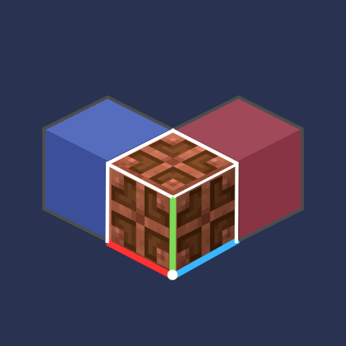

<div align="center">
  
  <h1>LitematicaBE</h1>
  <p><strong>基岩版服务器一站式投影集成的最佳方案</strong></p>
  <p>The best solution for one-stop projection integration of the Minecraft Bedrock Server.</p>

  <p>
    
    
    
    
    <a href="LICENSE"></a>
  </p>

  <p>
    <a href="#快速开始">快速开始</a>
    ·
    <a href="#兼容性">兼容性</a>
    ·
    <a href="#功能特性">功能特性</a>
    ·
    <a href="#命令">命令</a>
    ·
    <a href="#使用指南">使用指南</a>
    ·
    <a href="#从源码构建">从源码构建</a>
    ·
    <a href="#贡献">贡献</a>
    ·
    <a href="README_EN.md">English</a>
  </p>
</div>

LitematicaBE 是一个面向基岩版（BDS + LeviLamina）服务端的投影集成插件, 致力于为基岩版服务器提供一站式投影服务。


## 快速开始

> [!IMPORTANT]
> LitematicaBE 由「服务端插件 + BP/RP 扩展包」组成，全部内容在 LLBDS 服务端装载，玩家进入服务器自动推送资源包。本项目依赖前置库 [HologramLib](https://github.com/Ieckseyr/HologramLib)， 请在使用 LitematicaBE 前一并安装对应版本。

1. 安装前置与运行时：

   - **HologramLib**（必需）；
   - **lip**（已安装可跳过）：

    ```shell
    npm install -g @levimc/lip
    ```

2. **服务端**：在 BDS 根目录执行：

    ```shell
    lip install github.com/copper-lamp/LitematicaBE
    ```

    插件会安装到 `plugins/LitematicaBE/`，BP/RP 分别安装到 `behavior_packs/` 与 `resource_packs/`。

3. **启用扩展包**：把 BP/RP 的头 `pack_id` 与 `version` 写入 `worlds/<世界名>/world_behavior_packs.json` 和 `world_resource_packs.json`（或在存档中设置启用后上传存档至服务端），然后重启服务器。

    ```json
    [
      { "pack_id": "<BP 的 header.uuid>", "version": [1, 1, 89] }
    ]
    ```

4. 上传结构或投影文件：

   - 服务器管理员：把需要加载的文件手动放入 `plugins/LitematicaBE/schematics/`
   - 普通玩家：访问本插件提供的上传站地址并上传你的文件（见[使用指南](#网页上传投影结构文件)）

指定版本安装（推荐锁定版本）：

```shell
lip install github.com/copper-lamp/LitematicaBE@4.0.0
```

升级用 `lip update github.com/copper-lamp/LitematicaBE`。

## 兼容性

| 组件 | 版本 |
| ---- | ---- |
| Minecraft Bedrock Server | 1.21.13X |
| LeviLamina | 1.9.9 |
| HologramLib | 21.132.1 |

- 当前正在积极推进各版本适配中，如若存在兼容问题，请向我们反馈您的服务器游戏版本以优先适配。

## 功能特性

| 功能 | 说明 |
| ---- | ---- |
| 木剑面板 | 手持木剑召出控制面板，全功能支持可视化操作，交互友好型 UI |
| 投影加载 | 支持加载 Java 版 `.litematic` 或基岩版 `.mcstructure` 文件 |
| 投影导出 | 选区并保存为 Java 版 `.litematic` 或基岩版 `.mcstructure` 文件 |
| 投影放置 | geometry 假方块原生渲染，可自由放置旋转，支持百万级方块建筑（自行调整配置文件上限） |
| 逐层建造 | 可自由选择投影展示层级，一键快速切换 |
| 轻松放置 | 开启后自动校正当前放置方块种类及状态 |
| 投影打印机 | 开启后自动放置手长半径范围内的投影方块，无需人工操作 |
| 直接放置 | 直接读取 nbt 数据并写入世界，立刻生成建筑（需配置文件开启） |
| 投影管理 | 多投影独立会话同时存在，自由切换控制，支持投影共享 |
| 材料统计 | 一键统计投影材料清单并导出为 xlsx 表格，方便核对 |
| http 上传站 | 插件内置 HTTP 服务器，允许全体玩家自助上传投影文件，无需重启即生效 |

## 命令
- 本项目提供 木剑控制面板 和 命令控制 两套入口，此处列出命令表备用。

```shell
# 基础命令
/lit                           # 投影状态摘要
/lit load <file> <x> <y> <z>   # 指定原点铺设（不指定时默认为以玩家脚下为原点）
/lit unload                    # 卸载当前显示的投影
/lit list                      # 列出当前可用的 投影/结构 文件
/lit info <file>               # 解析 投影/结构 文件
/lit box                       # 包围盒线框开关
/lit share                     # 投影共享开关

# 会话与分层
/lit projects                  # 列出已加载的投影会话
/lit select <id>               # 切换当前选中的投影
/lit remove <id>               # 收回并删除某个投影会话
/lit layer <from> [to]         # 只看指定层区间
/lit rotate                    # 整体顺时针旋转 90°
/lit resend                    # 把当前显示层重推给所有在线玩家
/lit reload                    # 热重载映射表与打印机配置
/lit material                  # 统计当前选中投影的材料并导出 .xlsx

# 放置与建造
/lit place [from] [to]         # 直接放置（nbt直放，需服务端开启）
/lit easyplace                 # 轻松放置开关
/lit printer                   # 投影打印机开关

# 选区与保存
/lit sel                       # 选区状态（木剑右键方块两次选点；潜行 + 右键清空）
/lit sel clear                 # 清空选区并收回线框
/lit save stru <名字>          # 选区保存为 .mcstructure（基岩版结构文件）
/lit save lite <名字>          # 选区保存为 .litematic（Java 版投影文件）
/lit save both <名字>          # 两种格式都保存
/lit saveat <stru|lite|both> <名字> <x1> <y1> <z1> <x2> <y2> <z2>  # 按坐标保存
/lit saveinfo                  # 打印保存配置

# 凭据与诊断
/lit savediag                  # 诊断脚下一格：方块名、状态键值、NBT 类型、Java 口径
/lit diag                      # 代表方块的端到端自检（状态转换 + 是否生效 + hash 对比）
/lit probe                     # 能力矩阵检测
```

## 使用指南

### 加载与放置投影

1. 把 `.litematic` 或 `.mcstructure` 文件放进 `plugins/LitematicaBE/schematics/`（首次启动自动创建该目录）。
2. 游戏内执行 `/lit load <文件名>`（可省略扩展名；忽略大小写）。

```text
/lit load my_project
```

### 网页上传投影结构文件

服务器启动时插件在 `127.0.0.1:8686` 拉起一个轻量 HTTP 上传页：

1. 打开 `http:// <服务器IP地址> :8686/`（非公网 IP 服务器需自行设置反代）；
2. 令牌储存在 `plugins/LitematicaBE/config/upload.json` 的 `token`（首次启动自动生成）；
3. 浏览器打开地址，选择上传 `.litematic` / `.mcstructure`，文件自动落盘到 `plugins/LitematicaBE/schematics/`；
4. 回到游戏加载对应投影即可；
5. 单文件默认上限 64 MB（`maxSizeMb` 可调）。

> 启用上传站后将使服务器暴露在公网环境下，请自行配置防火墙和安全措施，避免给服务器带来可能的损失。

### 木剑控制面板

- 启用本插件后，游戏内手持木剑左键挥剑即可打开 LitematicaBE 控制面板。  
- 右键点击方块即可选区。  
- 右键 + 潜行点击可清除所有选区。  

```text
主菜单
│
├─ 投影管理
│   ├─ 投影操作
│   │   ├─ 卸载投影
│   │   ├─ 移除投影
│   │   ├─ 选为当前控制
│   │   ├─ 导出材料统计
│   │   └─ 重新加载
│   └─ 加载新投影
│
├─ 辅助功能
│   ├─ 轻松放置
│   ├─ 投影打印机
│   └─ 直接放置
│
├─ 选区保存
│   ├─ 保存为 .litematic
│   ├─ 保存为 .mcstructure
│   ├─ 双格式保存
│   ├─ 按坐标保存
│   └─ 清空选区
│
├─ 外观显示
│   ├─ 投影分享
│   ├─ 包围盒显示
│   ├─ 投影旋转
│   └─ 分层显示
│       ├─ 切换上一层
│       ├─ 切换下一层
│       ├─ 显示特定层
│       └─ 显示全部层
│
└─ 关于投影
```

部分功能配置参数见 `config`。  
控制面板具有与指令相同的功能。

## 从源码构建

### 前置

1. **LeviLamina 构建环境**：xmake 会从源码构建 `levilamina` 包，需要：

   - VS 2022 生成工具 + v143 工具集
   - C++ ATL

2. **HologramLib**：把与基线匹配的头文件与导入库放到仓库根的 `hologramlib/`：

    ```text
    hologramlib/
      include/hologramlib/HologramLib.h
      include/hologramlib/AbiCompat.h
      lib/HologramLib.lib
      holo_core.dll
      HologramLib.dll
    ```

    该目录被 `.gitignore` 忽略。缺失时不阻塞编译，插件以「无显示通道」形态构建。

### 构建

```powershell
powershell -NoProfile -ExecutionPolicy Bypass -File tools\update.ps1 -ServerRoot '<服务端目录>'
或
powershell -NoProfile -ExecutionPolicy Bypass -File tools\update.ps1 -ServerRoot '<服务端目录>' -Reconfigure   # 修改了 xmake.lua/依赖
```

### 部署

由 `tools/deploy.ps1` 完成（`update.ps1` 会自动调用）：

| 内容 | 目标位置 | 覆盖方式 |
| ---- | ---- | ---- |
| `bin/LitematicaBE/*` | `plugins/LitematicaBE/` | 就地覆盖，保留 `config/`、`data/` |
| `resources/addon/LitematicaBE_BP` | `behavior_packs/LitematicaBE_BP/` | 清空重写 |
| `resources/addon/LitematicaBE_RP` | `resource_packs/LitematicaBE_RP/` | 清空重写 |
| HologramLib 插件（前置） | `plugins/HologramLib/` | 不含，需自行安装 |

## 目录结构

```text
LitematicaBE/
├── src/LitematicaBE/         # 模组入口与模块
│   ├── LitematicaBE.h/.cpp   # 生命周期（load / enable / disable）
│   ├── Version.h             # 版本唯一真源
│   └── hologram/             # HologramLib 前置封装
├── resources/
│   ├── pack_icon.png         # 项目图标
│   ├── addon/                # BP / RP（假方块模型与贴图）
│   └── data/                 # 映射与规则表（由 tools/ 生成）
├── tools/                    # 离线 Python 工具链
│   └── legacy/               # 旧仓库的生成脚本，仅作参考
└── .github/workflows/        # build.yml（push/PR 校验）、release.yml（tag → Release）
```

## 离线工具链

`tools/` 下是与宿主无关的 Python 工具，只做资源生成、一致性校验与打包：

```bash
python -m lit_tools version     # 校验 Version.h / xmake.lua / lip.toml / CHANGELOG 一致
python -m lit_tools addon       # 校验 BP/RP 清单、方块定义与资源引用
python -m lit_tools mapping     # 从 BP 枚举假方块 → resources/data/generated/ghost_blocks.json
python -m lit_tools mapgen      # 旧映射索引 → 运行期 ghost_map.json，并校验 ghost 名都存在于 BP
python -m lit_tools fixture     # 生成 tests/fixtures 下的最小 .litematic 解析测例
```

## 敬请期待
- 更多实用功能开发（投影纠错、原理图编辑等）。
- 面向 Endstone 服务端兼容。

## 常见问题

**Q：没有适合我版本的LitematicaBE怎么办？**
A：请将你的 BDS 服务端版本以及 Levilamina 版本报告开发者，我们将优先进行适配及测试。

**Q：为什么部分功能存在问题？**
A：第四代 LitematicaBE 是 C++ 原生模组重写，部分功能尚未经大范围严格测试，若发现问题请向开发者反馈处理。

**Q：投影显示为未知或错误材质？**
A：Java 与基岩版差异较大，此类问题为映射表错误。若遇到请提交 Issue 并附上方块名与截图。

**Q：大型投影加载卡顿？**
A：受限于基岩版，帧率取决于玩家客户端渲染能力，服务端插件无法直接解决该问题。百万级超大投影建议先拆分或使用逐层显示。加载大型投影时请确保方块数不超过配置文件设定的一次加载上限。

**Q：启动后投影显示失效？**
A：检查 HologramLib 是否安装且版本与当前服务端版本匹配；`/lit probe` 会打印前置模块、编码器来源与 packetId，`/lit` 摘要里能看到当前显示通道。缺失 `holo_core.dll` 时会降级为逐格覆盖。

## 贡献

欢迎提交 Issue 与 Pull Request。
QQ 群：861900673
GitHub 仓库：
- <https://github.com/copper-lamp/LitematicaBE> （团队仓库，发布正式版）
- <https://github.com/Shisizhou0706/LitematicaBE-beta> （开发仓库，呈现最新代码）

## 致谢

- [Litematica](https://github.com/maruohon/litematica) — Java 版原理图模组，对 Minecraft 投影生态影响深远
- [LeviDev](https://github.com/LiteLDev) — 由 LeviMC 开发的 Levilamina 为本项目功能实现提供了基础
- [HologramLib](https://github.com/Ieckseyr/HologramLib) — 原生协议层渲染库，用于实现投影及包围盒显示功能
- [EasyPlace](https://github.com/wyl-gq/EasyPlace) — 借鉴其轻松放置及投影打印机的实现思想
- 以及所有为 LitematicaBE 作出贡献的开发者

## 许可证

- LitematicaBE 项目使用 AGPL-3.0 许可证。
- 使用修改版本并分发或用于提供服务时必须继续使用 AGPL-3.0，并公开源代码。配置文件修改不在此列。