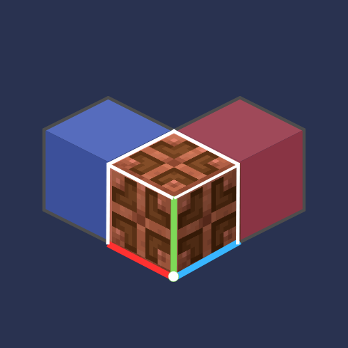

<div align="center">
  
  <h1>LitematicaBE</h1>
  <p><strong>基岩版服务器一站式投影集成的最佳方案</strong></p>
  <p>兼容 bedrock / java 双版本结构投影文件，使用 georetry 原生渲染，全服共享并发控制，优秀版本兼容性，一站式集成投影功能</p>

  <p>
    
    
    
    
    <a href="LICENSE"></a>
  </p>

  <p>
    <a href="#快速开始">快速开始</a>
    ·
    <a href="https://github.com/copper-lamp/LitematicaBE/releases">下载</a>
    ·
    <a href="CHANGELOG.md">更新日志</a>
    ·
    <a href="https://github.com/copper-lamp/LitematicaBE/issues">反馈问题</a>
    ·
    <a href="#贡献">贡献</a>
    ·
    <a href="README_EN.md">English</a>
  </p>
</div>

LitematicaBE 是一个面向基岩版（BDS + LeviLamina）服务端的投影插件：同时支持读取 .litematica 及 .mcstructure 双格式。采用 geometry 原生自定义方块写入投影，支持超大文件、逐层查看、投影打印机、litematica格式导出等实用功能。致力于为基岩版服务器提供一站式投影服务

## 快速开始

> [!IMPORTANT]
> LitematicaBE 由「服务端插件 + BP/RP 扩展包」组成，全部内容在 LLBDS 服务端装载，玩家进入服务器自动推送资源包。

1. 安装 lip（已安装可跳过）：

   ```shell
   npm install -g @levimc/lip
   ```

2. **服务端**：在 BDS 根目录执行：

   ```shell
   lip install github.com/copper-lamp/LitematicaBE
   ```

   插件会安装到 `plugins/LitematicaBE/`，BP/RP 分别安装到 `behavior_packs/` 与 `resource_packs/`。

3. **启用扩展包**：把 BP/RP 的头`pack_id` 与 `version` 写入 `worlds/<世界名>/world_behavior_packs.json` 和 `world_resource_packs.json`（或在存档中设置启用后上传存档至服务端），然后重启服务器。

   ```json
   [
     { "pack_id": "<BP 的 header.uuid>", "version": [1, 1, 8] }
   ]
   ```

4. 上传结构或投影文件：
- 服务器管理员：把需要加载的文件手动放入 `plugins/LitematicaBE/schematics/`
- 普通玩家：访问本插件提供的服务器上传站地址并上传你的文件（见使用指南部分）

指定版本安装（推荐锁定版本）：

```shell
lip install github.com/copper-lamp/LitematicaBE@3.1.0
```

升级用 `lip update github.com/copper-lamp/LitematicaBE`。

## 兼容性

| 组件 | 版本 |
| ---- | ---- |
| Minecraft Bedrock Server | 1.21.70+ |
| LeviLamina | 1.2.0+ |
| LegacyScriptEngine（nodejs 变体） | 0.11.0+ |
| LitematicaBE 插件 / addon | 随 Release 一同发布 |
- tip：本插件对服务端版本不敏感，以上为理论兼容范围，若存在兼容问题请报告处理。

## 功能特性

| 功能 | 说明 |
| ---- | ---- |
| 原理图加载 | 支持加载 Java 版 `.litematic` 或基岩版 `.mcstructure` 文件 |
| 原理图保存 | 把选区保存为 `.litematic`（与 Java 版 Litematica mod 互通）或基岩版 `.mcstructure`（可直接用结构方块加载）；导出时可选格式，也可两者同时导出 |
| 投影放置 | geometry 方块原生渲染，半透明显示，最贴近原版观感 |
| 逐层建造 | 手持木剑右键切换显示，抬头看上层 / 低头看下层 |
| 轻松放置 | 手持材料对准投影即可精确放置 |
| 投影打印机 | 开启后自动打印范围内投影，可限速、可逐层 |
| 直接放置 | OP + 创造模式把投影直接写入世界（NBT 直放） |
| 投影管理 | 多投影同时储存，全服玩家共享可见，自由切换控制，支持材料清单导出 |
| Mega 投影 | 分块存储、流式加载，最高可支持百万级超大型投影加载 |
| http上传站 | 插件内置 http 服务器，允许全体玩家自助上传投影文件，且无需重启即生效 |
| 更新检查 | 插件激活时自动检查仓库并提示新版本（可在 config 关闭该功能） |

### 操作方式

| 操作 | 说明 |
| ---- | ---- |
| 手持木剑 + 蹲下 + 点击 | 打开主菜单 |
| 抬头 / 低头 + 木剑右键 | 建造模式时切换显示层 |
| 平视 + 木剑点击 | 切换显示全部层 |
| `/lit` / `/litematica` | 命令系统入口 |

## 命令
- 以下命令功能可通过木剑打开主菜单可视化操作

```shell
# 基础命令
/litematica menu          # 打开主菜单
/litematica load <file>   # 加载原理图
/litematica place <file>  # 加载并在脚下放置投影
/litematica placeat X Y Z # 在指定坐标放置投影
/litematica easyplace     # 切换轻松放置
/litematica printer       # 切换投影打印机（也可用 /lit printer）
/litematica verify        # 验证方块放置正确性
/litematica materials     # 生成材料清单 Excel
/litematica save          # 保存原理图（选区模式）
/litematica build         # 切换到建造（逐层）模式
/litematica rotate        # 切换到旋转模式
/litematica list          # 列出所有投影
/litematica clear         # 清除当前投影显示
/litematica info          # 查看投影详细信息
/litematica debug <sub>   # 调试命令（mega/stats/config）
/litematica selfcheck     # 投影生成流程自检

# 工具命令
/litematica:logclean status|clean|config   # 日志清理
/litematica:config reload|reset|get <key>  # 配置管理
/litematica:ghost lay|undo|info|restore    # ghost 测试
/litematica:web status|start|stop|restart  # 网页上传站
/litematica:web token|url                  # 查看/重生成上传令牌、访问地址
```

## 使用指南

### 加载与放置投影

1. 把 `.litematic` 或 `.mcstructure` 文件放进 `plugins/LitematicaBE/schematics/`。
2. 手持木剑蹲下点击打开 LitematicaBE 主菜单，点击「加载投影」并选择文件。
3. 在放置面板调整坐标，提交后投影显示在目标位置。

### 网页上传投影结构文件

服务器启动时插件会拉起一个轻量 HTTP 上传站。

1. 在 `config.json` 中设置服务器公网 IP 并开放相应端口（默认8080）（NAT 网络需部署反代）；
2. 服务端启动后控制台输出：`[Web] 上传站已启动 http://<地址>:8080/`；
3. 若启用令牌认证：令牌首次自动生成并写入 `plugins/LitematicaBE/data/web_token.txt`；也可用 `/litematica:web token` 重新生成（旧地址立即失效）；
4. 浏览器打开地址，选择上传 `.litematic` / `.mcstructure` ，文件自动放入 `plugins/LitematicaBE/schematics/`，游戏内立刻可用，无需重启。
5. 上传方式为分片 + base64，单文件上限 `web.maxFileMB`（默认 64MB），支持断点续传。

上传站配置参数见 `config.json`

### 版本更新检查

服务端启动、插件被激活时，向 GitHub Release 问一次最新版本，结果只往控制台打一行日志：

1. 有新版：`[LitematicaBE]发现新版本vX.Y.Z，前往https://github.com/copper-lamp/LitematicaBE以了解更多`；
2. 已是最新：`[LitematicaBE]当前已是最新版本`；
3. 取数顺序：GitHub API → 官方网页（API 不可用时读 `releases/latest` 的 302）→ `updateCheck.mirror`（若配置，支持 `{repo}` 占位，例如 `"mirror": "https://gh-proxy.com/https://api.github.com/repos/{repo}/releases/latest"`）；
4. 只查这一次，不复查、不重试；断网、被墙、限流只打一条 `[LitematicaBE]版本检查失败：…`，插件其它功能完全不受影响；
5. 只读元数据：**不下载、不写入、不自动更新**；
6. 关闭：`"updateCheck": { "enabled": false }` —— 完全不联网，连任务都不注册。

更新检查配置参数见 `config.json`

### 逐层建造

1. 投影操作面板中开启**逐层显示**。
2. 木剑右键：**抬头**切到上一层，**低头**切到下一层，平视切回全部层。

### 轻松放置

1. 在投影操作面板开启**轻松放置**，手持材料对准投影即可精确放置。
2. 同时具有**投影打印机**功能（`/litematica printer` 或 `/lit printer`）；再次点击菜单可关闭。
3. 打印机只填 ghost / 空气 / 花草雪水这类可替换方块，**不会覆盖其它方块**；逐层模式下只放当前层。

打印机配置参数见 `config.json`

### 直接放置（管理员）

1. 需要 **OP 权限 + 创造模式**；
2. 在「投影管理」中选择已放置的投影并进入详情，点击「直接放置全部方块」。

### 保存原理图

1. 打开菜单点击**保存投影**，点击「开始选区」，用木剑右键选取两个对角点；
2. 选区完成后先在表单顶部的「导出格式」里选：`.litematic`（Java 版 Litematica）/ `.mcstructure`（基岩版结构方块文件）/ 两者都导出；
3. 再输入名称与描述即可保存。`.mcstructure` **不压缩**（约 8 字节/格），因此受 `schematicSave.maxVolume` 限制（默认 100 万格 ≈ 100×100×100）；超限的选区会在读取任何方块之前就被拒绝。

### 验证

放置投影后在投影操作面板点击**验证投影**，系统会报告匹配 / 差异 / 缺失 / 错误方块。

## 手动安装

不使用 lip 时，可下载 Release 中的 `LitematicaBE-<版本>.zip`：

1. 将 `plugins/LitematicaBE/` 解压到 BDS 的 `plugins/` 目录；
2. 将 `LitematicaBE-BP/`、`LitematicaBE-RP/` 分别放到 BDS 的 `behavior_packs/` 与 `resource_packs/`；
3. 按「快速开始」第 4 步在世界中启用扩展包，然后重启服务器。

## 目录结构

```text
LitematicaBE/
├── index.js                        # 插件入口：命令注册、事件、各子系统装配
├── manifest.json                   # LSE 插件清单（可被直接复制进 plugins/）
├── tooth.json                      # lip 包清单（v3，含服务端默认变体与 client 变体）
├── config.json                     # 用户配置（允许 // 注释与尾随逗号）
├── package.json                    # 运行时依赖（仅 xlsx）
├── src/
│   ├── core/                       # NBT、.litematic 解析、流式加载、Mega 分块存储、配置、日志、选区
│   ├── render/                     # 渲染调度：ProjectionRenderer、RenderScheduler、LODRenderer、MegaProjectionRenderer
│   ├── ghost/                      # ghost 方块注册/守护/校验，addon 版本一致性检查
│   ├── easyplace/                  # 轻松放置：射线、库存、放置校验
│   ├── mappings/                   # Java ↔ 基岩方块/状态映射
│   ├── ui/                         # 表单 UI
│   ├── utils/                      # 材质统计等工具
│   ├── data/                       # 存档、世界快照
│   ├── world/                      # 世界相关模块
│   └── web/                        # 内置 HTTP 上传站：WebUploadServer、upload.html、uploadGuard
├── resources/
│   ├── pack_icon.png               # 项目图标
│   ├── addon/                      # BP / RP 源文件（LitematicaBE_BP、_RP，已入库）
│   └── data/                       # 运行时索引：ghost_index.json、addon_expected.json
├── tools/                          # 构建工具：zip.mjs、check-version.mjs、build-release.mjs（仅这三个入库）
├── tests/                          # 离线回归测试（35 个 test_*.js + 2 个体检器 + run_all.js；npm test 串跑）
└── .github/workflows/              # ci.yml（push/PR 校验 + 测试 + 构建）、release.yml（tag → Release）
```

## 从源码构建

需要 Node.js 20+。构建产物输出到 `build/`：

```shell
npm ci
node tools/check-version.mjs
npm run build
```

产物包括：

| 文件 | 用途 |
| ---- | ---- |
| `LitematicaBE-<版本>.zip` | 手动安装包 |
| `SHA256SUMS.txt` | 校验和 |

## 常见问题

**Q：为什么部分功能存在问题？**
A：第三代 LitematicaBE 正在重构更新中，部分功能尚未经大范围严格测试，若发现问题请向开发者反馈处理。

**Q：投影显示为未知或错误材质？**
A：多为方块映射问题。Java 与基岩版方块差异较大，遇到请提交 Issue 并附上方块名与截图。

**Q：ghost 写入被禁用 / 提示版本不一致？**
A：插件与服务端 addon（BP/RP） 必须为同批版本。重新执行 `/litematica selfcheck` 查看具体项，并确认世界已启用对应扩展包。

**Q：大型投影加载卡顿？**
A：受限于基岩版，帧率取决于玩家客户端渲染能力，服务端插件无法直接解决该问题。数十万级超大投影建议先拆分或用逐层显示。（后期将推出相应优化）

**Q：保存的原理图能在 Java 版打开吗？**
A：选 `.litematic` 时可以，格式兼容 Java 版 Litematica。

**Q：保存的 `.mcstructure` 和结构方块是什么关系？**
A：只是同一种文件格式。`.mcstructure` 由结构方块导出/加载，但文件本身只是未压缩的小端 NBT，本插件直接读写它，因此**不受结构方块 64×384×64 的选取/放置范围限制**；唯一的上限是 `schematicSave.maxVolume`。

## 贡献

欢迎提交 Issue 与 Pull Request。  
QQ 群：861900673  
GitHub：<https://github.com/copper-lamp/LitematicaBE>

## 致谢

- [Litematica](https://github.com/maruohon/litematica) — Java 版原理图模组，对 Minecraft 投影生态影响深远
- [LeviDev](https://github.com/LiteLDev) — 由 LeviMC 开发的 Levilamina 及 LegacyScriptEngine 为本项目功能实现提供了基础
- [EasyPlace](https://github.com/wyl-gq/EasyPlace) — 借鉴其部分功能实现
- 以及所有为 LitematicaBE 作出贡献的开发者

## 许可证

- LitematicaBE 项目使用 AGPL-3.0 许可证。
- 使用修改版本并分发或用于提供服务时必须继续使用 AGPL-3.0，并提供源代码。
