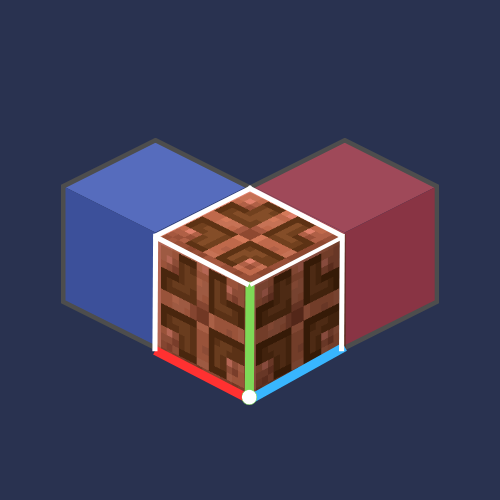

<div align="center">
  
  <h1>LitematicaBE</h1>
  <p><strong>The Optimal Solution for One-Stop Projection Integration on Minecraft Bedrock Servers</strong></p>
  <p>Compatible with both bedrock / java dual-version structure projection files, uses native geometry rendering, server-wide shared concurrency control, excellent version compatibility, and one-stop projection integration.</p>

  <p>
    
    
    
    
    <a href="LICENSE"></a>
  </p>

  <p>
    <a href="#quick-start">Quick Start</a>
    ·
    <a href="https://github.com/copper-lamp/LitematicaBE/releases">Downloads</a>
    ·
    <a href="CHANGELOG.md">Changelog</a>
    ·
    <a href="https://github.com/copper-lamp/LitematicaBE/issues">Report an issue</a>
    ·
    <a href="#contributing">Contributing</a>
    ·
    <a href="README.md">简体中文</a>
  </p>
</div>

LitematicaBE is a projection integration plugin for Bedrock Edition (BDS + LeviLamina) servers: cross-version compatibility that works with most servers. It reads both `.litematic` and `.mcstructure` formats. Projections are written with native geometry custom blocks, and it supports very large files, layer-by-layer viewing, a projection printer, one-click placement, and schematic/structure file export. It aims to provide one-stop projection services for Bedrock servers.

## Quick Start

> [!IMPORTANT]
> LitematicaBE consists of a server plugin plus BP/RP addon packs. Everything is loaded on the LLBDS server, and the resource pack is automatically pushed to players when they join.

1. Install lip (skip if already installed):

   ```shell
   npm install -g @levimc/lip
   ```

2. **Server**: run this from the BDS root directory:

   ```shell
   lip install github.com/copper-lamp/LitematicaBE
   ```

   The plugin is installed to `plugins/LitematicaBE/`; the BP and RP are installed to `behavior_packs/` and `resource_packs/` respectively.

3. **Enable the packs**: write the BP/RP `pack_id` and `version` into `worlds/<world name>/world_behavior_packs.json` and `world_resource_packs.json` (or enable them in the world and upload the world to the server), then restart the server.

   ```json
   [
     { "pack_id": "<header.uuid of the BP>", "version": [1, 1, 8] }
   ]
   ```

4. Upload the structure or projection file:
- Server administrators: manually place the files to load into `plugins/LitematicaBE/schematics/`
- Regular players: visit the plugin's server upload station and upload your files (see the Usage guide below)

Install a specific version (recommended to pin a version):

```shell
lip install github.com/copper-lamp/LitematicaBE@3.1.0
```

Upgrade with `lip update github.com/copper-lamp/LitematicaBE`.

## Compatibility

| Component | Version |
| --------- | ------- |
| Minecraft Bedrock Server | 1.21.70+ |
| LeviLamina | 1.2.0+ |
| LegacyScriptEngine (nodejs variant) | 0.11.0+ |
| LitematicaBE plugin / addon | Published together with each release |
- Note: this plugin is not sensitive to the server version; the above is the theoretical compatibility range. Please report any compatibility issues you find.

## Features

| Feature | Description |
| ------- | ----------- |
| Schematic loading | Load Java Edition `.litematic` or Bedrock `.mcstructure` files |
| Schematic saving | Save a selection as `.litematic` (interoperable with the Java Edition Litematica mod) or Bedrock `.mcstructure` (loadable directly with structure blocks); the format is chosen at export, or you can export both at once |
| Projection placement | Rendered with native geometry blocks, translucent display, closest to the vanilla look |
| Layer-by-layer building | Right-click with a wooden sword to switch the display; look up for the upper layer, down for the lower layer |
| Easy place | Aim at the projection with materials in hand to place precisely |
| Projection printer | When enabled, automatically prints the projection in range; rate-limited and layer-aware |
| Direct placement | OP + Creative writes the projection directly into the world (NBT placement) |
| Projection management | Store multiple projections at once, visible to all players on the server, freely switch control, material list export |
| Mega projection | Chunked storage, streaming load, supports up to million-block ultra-large projections |
| HTTP upload station | Built-in HTTP server that lets all players upload projection files themselves, effective without a restart |
| Update check | Automatically checks the repository when the plugin is activated and notifies of a new version (can be disabled in config) |

### Controls

| Action | Description |
| ------ | ----------- |
| Wooden sword + sneak + click | Open the main menu |
| Look up / down + sword right-click | Switch the displayed layer in build mode |
| Look straight + sword click | Show all layers |
| `/lit` / `/litematica` | Command entry points |

## Commands
- The commands below can also be operated visually through the wooden sword main menu

```shell
# Core commands
/litematica menu          # open the main menu
/litematica load <file>   # load a schematic
/litematica place <file>  # load and place a projection at your feet
/litematica placeat X Y Z # place a projection at the given coordinates
/litematica easyplace     # toggle easy place
/litematica printer       # toggle the projection printer (also `/lit printer`)
/litematica verify        # verify block placement correctness
/litematica materials     # generate the material list Excel
/litematica save          # save a schematic (selection mode)
/litematica build         # switch to build (layer) mode
/litematica rotate        # switch to rotate mode
/litematica list          # list all projections
/litematica clear         # clear the current projection display
/litematica info          # show projection details
/litematica debug <sub>   # debug commands (mega/stats/config)
/litematica selfcheck     # self-check the projection generation pipeline

# Utility commands
/litematica:logclean status|clean|config   # log cleaner
/litematica:config reload|reset|get <key>  # configuration
/litematica:web status|start|stop|restart  # web upload station
/litematica:web token|url                  # view/regenerate the upload token and access URL
```

## Usage

### Loading and placing a projection

1. Put the `.litematic` or `.mcstructure` file into `plugins/LitematicaBE/schematics/`.
2. Sneak and click with a wooden sword to open the LitematicaBE main menu, click **Load projection**, and pick a file.
3. Adjust the coordinates in the placement panel; after submitting, the projection appears at the target position.

### Uploading projection files via the web

The plugin starts a lightweight HTTP upload station when the server starts.

1. Set the server's public IP in `config.json` and open the corresponding port (default 8080) (NAT networks need a reverse proxy);
2. After the server starts, the console prints: `[Web] Upload station started at http://<address>:8080/`;
3. If token authentication is enabled: the token is auto-generated on first use and written to `plugins/LitematicaBE/data/web_token.txt`; you can also use `/litematica:web token` to regenerate it (the old address stops working immediately);
4. Open the address in a browser, choose to upload a `.litematic` / `.mcstructure`, and the file is automatically placed into `plugins/LitematicaBE/schematics/`, usable in-game immediately with no restart.
5. Upload uses chunked + base64 transfer, with a per-file limit of `web.maxFileMB` (default 64MB) and resumable upload support.

See `config.json` for the upload station configuration.

### Layer-by-layer building

1. Enable **layer display** in the projection actions panel.
2. Sword right-click: look **up** for the next layer, look **down** for the previous layer, look straight ahead to return to all layers.

### Easy place

1. Enable **easy place** in the projection actions panel, then aim at the projection with materials in hand to place precisely.
2. It also has the **projection printer** feature (`/litematica printer` or `/lit printer`); click the menu again to disable it.
3. The printer only fills ghost / air / replaceable blocks such as grass, flowers, snow, and water; it will **never overwrite other blocks**; in layer mode it only places the current layer.

See `config.json` for the printer configuration.

### Direct placement (administrators)

1. Requires **OP** and **Creative** mode;
2. In **Projection management**, choose the placed projection, open its details, and click **Place all blocks directly**.

### Saving a schematic

1. Open the menu, click **Save projection**, click **Start selection**, and mark two opposite corners with a wooden sword right-click;
2. After selecting, first choose the **export format** at the top of the form: `.litematic` (Java Edition projection file) / `.mcstructure` (Bedrock structure file) / export both;
3. Then enter a name and an optional description to save.

### Verification

After placing a projection, click **Verify projection** in the projection actions panel; the system reports matching / differing / missing / wrong blocks.

### Version update check

When the server starts and the plugin is activated, it checks GitHub Releases over the network for version updates.

See `config.json` for the update check configuration.

## Manual installation

When not using lip, download `LitematicaBE-<version>.zip` from the release:

1. Extract `plugins/LitematicaBE/` into the BDS `plugins/` directory;
2. Place `LitematicaBE-BP/` and `LitematicaBE-RP/` into the BDS `behavior_packs/` and `resource_packs/` respectively;
3. Enable the packs in the world as described in Quick Start step 4, then restart the server.

## Repository layout

```text
LitematicaBE/
├── index.js                        # plugin entry point
├── manifest.json                   # LSE plugin manifest
├── tooth.json                      # lip package manifest (v3)
├── config.json                     # user configuration
├── package.json                    # runtime dependency (xlsx only)
├── src/
│   ├── core/                       # feature core
│   ├── render/                     # rendering scheduling
│   ├── ghost/                      # ghost block registration/guard/validation, addon version consistency check
│   ├── easyplace/                  # easy place: ray, inventory, placement validation
│   ├── mappings/                   # Java ↔ Bedrock block/state mappings
│   ├── net/                        # update check
│   ├── ui/                         # form UI
│   ├── utils/                      # material stats and other utilities
│   ├── data/                       # save data, world snapshots
│   ├── world/                      # world-related modules
│   └── web/                        # built-in HTTP upload station
├── resources/
│   ├── pack_icon.png               # project icon
│   ├── addon/                      # BP / RP source files (LitematicaBE_BP, _RP)
│   └── data/                       # runtime index: ghost_index.json, addon_expected.json
├── tools/                          # build tools
├── tests/                          # offline regression tests
└── .github/workflows/              # ci.yml (push/PR validation + tests + build), release.yml (tag → Release)
```

## Build from source

Node.js 20+ is required. Artifacts are written to `build/`:

```shell
npm ci
node tools/check-version.mjs
npm run build
```

Artifacts include:

| File | Purpose |
| ---- | ------- |
| `LitematicaBE-<version>.zip` | Manual installation package (contains the plugin and resource packs) |
| `SHA256SUMS.txt` | Checksums |

## FAQ

**Q: Why do I find some features problematic?**
A: The third-generation LitematicaBE is still being refactored; some features have not been widely and strictly tested yet. If you find an issue, please report it to the developer.

**Q: The projection shows unknown or wrong textures.**
A: Usually a block mapping issue. Java and Bedrock blocks differ significantly; if you run into this, submit an Issue with the block name and a screenshot.

**Q: Ghost writes are disabled / a version mismatch is reported?**
A: The plugin and the server addon (BP/RP) must be from the same batch version. Re-run `/litematica selfcheck` to see the specific items, and confirm the world has the corresponding packs enabled.

**Q: Large projections lag when loading?**
A: Due to Bedrock limitations, the frame rate depends on the player client's rendering capability; the server plugin cannot directly solve this. For ultra-large projections of hundreds of thousands of blocks, split them first or use layer-by-layer display. (Optimizations will be released later.)

**Q: Can saved schematics be opened in Java Edition?**
A: Exports in `.litematic` format are compatible with Java Edition Litematica and can be used directly.

## Contributing

Issues and pull requests are welcome.
QQ group: 861900673
GitHub: <https://github.com/copper-lamp/LitematicaBE>

## Acknowledgements

- [Litematica](https://github.com/maruohon/litematica) — the Java Edition schematic mod, which has had a profound impact on the Minecraft projection ecosystem
- [LeviDev](https://github.com/LiteLDev) — LeviLamina and LegacyScriptEngine developed by LeviMC provide the foundation for this project's features
- [EasyPlace](https://github.com/wyl-gq/EasyPlace) — some feature implementations are borrowed from it
- And all the developers who have contributed to LitematicaBE

## License

- The LitematicaBE project is licensed under AGPL-3.0.
- Modified versions that are distributed or used to provide a service must remain under AGPL-3.0 and provide the corresponding source code.
