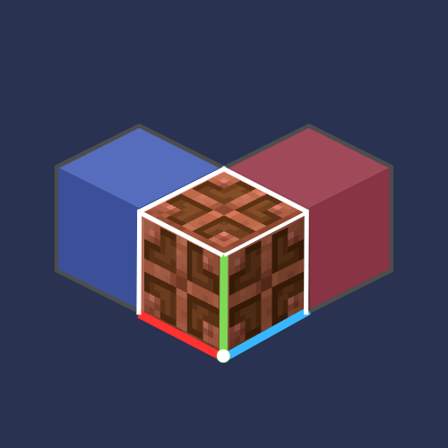

<div align="center">
  
  <h1>LitematicaBE</h1>
  <p><strong>The best solution for one-stop schematic integration on Minecraft Bedrock servers</strong></p>

  <p>
    
    
    
    
    <a href="LICENSE"></a>
  </p>

  <p>
    <a href="#quick-start">Quick Start</a>
    ·
    <a href="#compatibility">Compatibility</a>
    ·
    <a href="#features">Features</a>
    ·
    <a href="#commands">Commands</a>
    ·
    <a href="#usage-guide">Usage Guide</a>
    ·
    <a href="#building-from-source">Building from Source</a>
    ·
    <a href="#contributing">Contributing</a>
    ·
    <a href="README.md">中文</a>
  </p>
</div>

LitematicaBE is a schematic integration add-on for Bedrock Dedicated Server (BDS + LeviLamina), built to deliver a one-stop schematic service for Bedrock servers.


## Quick Start

> [!IMPORTANT]
> LitematicaBE is made of a **server-side add-on plus BP/RP add-on packs** — everything is loaded on the LLBDS server, and the resource pack is pushed to players as soon as they join. The project depends on the [HologramLib](https://github.com/Ieckseyr/HologramLib) library, so install the matching version alongside LitematicaBE.

1. Install the dependency and runtime:

   - **HologramLib** (required);
   - **lip** (skip if already installed):

    ```shell
    npm install -g @levimc/lip
    ```

2. **Server**: run this in the BDS root directory:

    ```shell
    lip install github.com/copper-lamp/LitematicaBE
    ```

    The add-on installs to `plugins/LitematicaBE/`, and the BP/RP install to `behavior_packs/` and `resource_packs/` respectively.

3. **Enable the add-on packs**: write the `pack_id` and `version` from the BP/RP headers into `worlds/<world name>/world_behavior_packs.json` and `world_resource_packs.json` (or enable them in a world on the client and upload that world to the server), then restart the server.

    ```json
    [
      { "pack_id": "<BP header.uuid>", "version": [1, 1, 89] }
    ]
    ```

4. Upload schematics or structure files:

   - Server admins: drop the files you want to load into `plugins/LitematicaBE/schematics/` manually
   - Regular players: open the upload site this add-on provides and upload your files (see [Uploading schematic/structure files through the web](#uploading-schematicstructure-files-through-the-web))

Install a specific version (pinning is recommended):

```shell
lip install github.com/copper-lamp/LitematicaBE@4.0.0
```

To upgrade, run `lip update github.com/copper-lamp/LitematicaBE`.

## Compatibility

| Component | Version |
| ---- | ---- |
| Minecraft Bedrock Server | 1.21.13X |
| LeviLamina | 1.9.9 |
| HologramLib | 21.132.1 |

- Version support is being actively expanded. If you run into a compatibility problem, tell us your server's game version and we will prioritise it.

## Features

| Feature | Description |
| ---- | ---- |
| Wooden Sword Panel | Swing a wooden sword to bring up the control panel — every feature has a visual, user-friendly UI |
| Schematic Loading | Load Java Edition `.litematic` or Bedrock Edition `.mcstructure` files |
| Schematic Export | Select an area and save it as a Java Edition `.litematic` or Bedrock Edition `.mcstructure` file |
| Schematic Placement | Natively rendered `geometry` ghost blocks; place and rotate them freely; handles builds with millions of blocks (raise the cap in the config yourself) |
| Layer-by-Layer Building | Pick any layer range of a schematic and switch layers with a single click |
| Easy Place | Once enabled, automatically corrects the block type and block states of whatever you place |
| Schematic Printer | Once enabled, automatically places the schematic blocks within your reach distance, with no manual input |
| Direct Place | Reads the NBT data and writes it straight into the world, generating the build instantly (must be enabled in the config) |
| Schematic Management | Multiple schematics live in independent sessions that you can switch between freely, with schematic sharing |
| Material List | One click to tally the selected schematic's materials and export them to an `.xlsx` sheet for easy checking |
| HTTP Upload Site | A built-in HTTP server lets all players upload schematic files themselves, taking effect without a restart |

## Commands

- This project offers two entry points — the wooden sword control panel and commands. The command table is listed here as a fallback.

```shell
# Basic commands
/lit                           # schematic status summary
/lit load <file> <x> <y> <z>   # load at the given origin (defaults to the block under the player)
/lit unload                    # unload the currently displayed schematic
/lit list                      # list the available schematic/structure files
/lit info <file>               # parse a schematic/structure file
/lit box                       # toggle the bounding box wireframe
/lit share                     # toggle schematic sharing

# Sessions and layers
/lit projects                  # list the loaded schematic sessions
/lit select <id>               # switch the currently selected schematic
/lit remove <id>               # remove and delete a schematic session
/lit layer <from> [to]         # show only the given layer range
/lit rotate                    # rotate 90° clockwise
/lit resend                    # re-send the current layer to all online players
/lit reload                    # hot-reload the mapping table and printer config
/lit material                  # tally the selected schematic's materials and export an .xlsx

# Placing and building
/lit place [from] [to]         # direct place (writes NBT straight in, must be enabled server-side)
/lit easyplace                 # toggle Easy Place
/lit printer                   # toggle the schematic printer

# Selection and saving
/lit sel                       # selection status (right-click two blocks with the wooden sword to set the corners; sneak + right-click to clear)
/lit sel clear                 # clear the selection and remove the wireframe
/lit save stru <name>          # save the selection as .mcstructure (Bedrock structure file)
/lit save lite <name>          # save the selection as .litematic (Java Edition schematic file)
/lit save both <name>          # save both formats
/lit saveat <stru|lite|both> <name> <x1> <y1> <z1> <x2> <y2> <z2>  # save by coordinates
/lit saveinfo                  # print the save settings

# Credentials and diagnostics
/lit savediag                  # diagnose the block below: block name, state keys/values, NBT types, Java-side mapping
/lit diag                      # end-to-end self-test on a representative block (state conversion + whether it applies + hash comparison)
/lit probe                     # capability matrix probe
```

## Usage Guide

### Loading and Placing Schematics

1. Put the `.litematic` or `.mcstructure` files into `plugins/LitematicaBE/schematics/` (the folder is created automatically on first launch).
2. Run `/lit load <file name>` in game (the extension can be omitted; case-insensitive).

```text
/lit load my_project
```

### Uploading schematic/structure files through the web

On server startup the add-on spins up a lightweight HTTP upload page at `127.0.0.1:8686`:

1. Open `http://<server IP>:8686/` (servers without a public IP need a reverse proxy set up yourself);
2. The token is stored in `token` in `plugins/LitematicaBE/config/upload.json` (generated automatically on first launch);
3. Open the address in a browser and select the `.litematic` / `.mcstructure` file to upload — it is written to `plugins/LitematicaBE/schematics/` automatically;
4. Go back in game and load the schematic;
5. The default per-file limit is 64 MB (`maxSizeMb` is adjustable).

> Enabling the upload site exposes your server to the public internet. Set up your own firewall and security measures to avoid possible damage to the server.

### Wooden Sword Panel

- With the add-on enabled, hold a wooden sword in game and swing it (left-click) to open the LitematicaBE control panel.
- Right-click blocks to make a selection.
- Sneak + right-click to clear the whole selection.

```text
Main Menu
│
├─ Schematic Management
│   ├─ Schematic Actions
│   │   ├─ Unload Schematic
│   │   ├─ Remove Schematic
│   │   ├─ Select as Current
│   │   ├─ Export Material List
│   │   └─ Reload
│   └─ Load New Schematic
│
├─ Utilities
│   ├─ Easy Place
│   ├─ Schematic Printer
│   └─ Direct Place
│
├─ Save Selection
│   ├─ Save as .litematic
│   ├─ Save as .mcstructure
│   ├─ Save Both Formats
│   ├─ Save by Coordinates
│   └─ Clear Selection
│
├─ Display
│   ├─ Schematic Sharing
│   ├─ Bounding Box
│   ├─ Rotate Schematic
│   └─ Layer View
│       ├─ Previous Layer
│       ├─ Next Layer
│       ├─ Show Specific Layer
│       └─ Show All Layers
│
└─ About
```

Some feature settings live in `config`.
The control panel offers the same functionality as the commands.

## Building from Source

### Prerequisites

1. **LeviLamina build environment**: xmake builds the `levilamina` package from source, which requires:

   - VS 2022 Build Tools + the v143 toolset
   - C++ ATL

2. **HologramLib**: put the headers and import libraries matching the baseline into `hologramlib/` at the repo root:

    ```text
    hologramlib/
      include/hologramlib/HologramLib.h
      include/hologramlib/AbiCompat.h
      lib/HologramLib.lib
      holo_core.dll
      HologramLib.dll
    ```

    The directory is ignored by `.gitignore`. A missing copy does not block compilation — the add-on then builds in a "no display channel" form.

### Build

```powershell
powershell -NoProfile -ExecutionPolicy Bypass -File tools\update.ps1 -ServerRoot '<server root>'
# or
powershell -NoProfile -ExecutionPolicy Bypass -File tools\update.ps1 -ServerRoot '<server root>' -Reconfigure   # after changing xmake.lua/dependencies
```

### Deployment

Handled by `tools/deploy.ps1` (called automatically by `update.ps1`):

| Contents | Destination | Overwrite policy |
| ---- | ---- | ---- |
| `bin/LitematicaBE/*` | `plugins/LitematicaBE/` | Overwritten in place, `config/` and `data/` preserved |
| `resources/addon/LitematicaBE_BP` | `behavior_packs/LitematicaBE_BP/` | Wiped and rewritten |
| `resources/addon/LitematicaBE_RP` | `resource_packs/LitematicaBE_RP/` | Wiped and rewritten |
| HologramLib add-on (dependency) | `plugins/HologramLib/` | Not included — install it yourself |

## Repository Layout

```text
LitematicaBE/
├── src/LitematicaBE/         # mod entry point and modules
│   ├── LitematicaBE.h/.cpp   # lifecycle (load / enable / disable)
│   ├── Version.h             # single source of truth for the version
│   └── hologram/             # HologramLib dependency wrapper
├── resources/
│   ├── pack_icon.png         # project icon
│   ├── addon/                # BP / RP (ghost block models and textures)
│   └── data/                 # mapping and rule tables (generated by tools/)
├── tools/                    # offline Python toolchain
│   └── legacy/               # generation scripts from the old repo, reference only
└── .github/workflows/        # build.yml (push/PR checks), release.yml (tag → Release)
```

## Offline Toolchain

`tools/` holds host-agnostic Python tooling that only handles resource generation, consistency checks and packaging:

```bash
python -m lit_tools version     # check that Version.h / xmake.lua / lip.toml / CHANGELOG agree
python -m lit_tools addon       # check the BP/RP manifests, block definitions and resource references
python -m lit_tools mapping     # enumerate ghost blocks from the BP → resources/data/generated/ghost_blocks.json
python -m lit_tools mapgen      # legacy mapping index → runtime ghost_map.json, checking every ghost name exists in the BP
python -m lit_tools fixture     # generate minimal .litematic parsing fixtures under tests/fixtures
```

## Coming Soon

- More practical features in development (schematic verification, schematic editing, etc.).
- Endstone server support.

## FAQ

**Q: Why are some features broken?**
A: The fourth-generation LitematicaBE is a native C++ rewrite, and some features have not yet been rigorously tested at scale. If you find a problem, report it to the developer.

**Q: Why does a schematic show up as unknown or wrong materials?**
A: Java and Bedrock Edition differ a lot, and this class of problem comes from errors in the mapping table. If you hit it, open an issue with the block name and a screenshot.

**Q: Why do large schematics cause lag when loading?**
A: This is a Bedrock limitation — framerate depends on the player client's rendering power, and a server-side add-on cannot solve it directly. For huge million-block schematics, split them up first or use layer view. When loading large schematics, make sure the block count stays under the single-load cap set in the config.

**Q: Why does schematic display stop working after startup?**
A: Check that HologramLib is installed and that its version matches your current server version; `/lit probe` prints the dependency module, encoder source and packetId, and the `/lit` summary shows the current display channel. Without `holo_core.dll` it falls back to per-block overriding.

## Contributing

Issues and pull requests are welcome.
QQ group: 861900673
GitHub repositories:
- <https://github.com/copper-lamp/LitematicaBE> (team repo, official releases)
- <https://github.com/Shisizhou0706/LitematicaBE-beta> (development repo, latest code)

## Credits

- [Litematica](https://github.com/maruohon/litematica) — the Java Edition schematic mod that shaped Minecraft's schematic ecosystem
- [LeviDev](https://github.com/LiteLDev) — LeviLamina by LeviMC, the foundation this project's features are built on
- [HologramLib](https://github.com/Ieckseyr/HologramLib) — native protocol-level rendering library used for schematic and bounding box display
- [EasyPlace](https://github.com/wyl-gq/EasyPlace) — its Easy Place and printer approach inspired our implementation
- And every developer who has contributed to LitematicaBE

## License

- LitematicaBE is licensed under AGPL-3.0.
- Modified versions that are distributed or used to provide a service must stay under AGPL-3.0 and publish their source code. Config-file changes are not covered by this.
